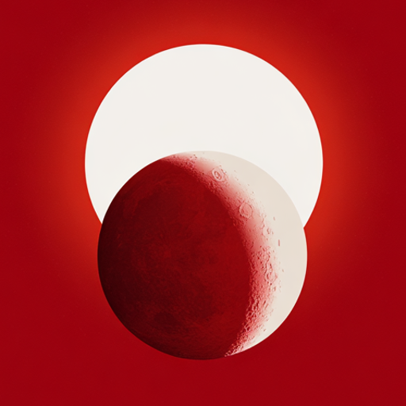

<p align="center">
  
</p>

<h1 align="center">Circadian Pro</h1>

<p align="center">
  Advanced circadian lighting control for Home Assistant.
</p>

## Overview

Circadian Pro automatically adjusts the brightness and color temperature of your lights throughout the day according to sunrise, sunset and your configured preferences.

It supports multiple independent instances, manual-control detection, automatic sleep mode, calibrated RGB/RGBW/RGB+CCT lighting and several brightness-transition profiles.

**Current stable version:** `0.21.16`

The [full audit report](docs/auditoria-2026-10-13.md) records the reproduced issues, fixes and validation limits from 0.21.4. Version 0.21.16 replaces the two static timing diagrams with one interactive curve and adds 0–240 minute sliders; see the [release notes](docs/release-0.21.16.md).

## Features

- Automatic brightness and color-temperature adaptation.
- Multiple independent Circadian Pro instances.
- Natural, Linear and Sigmoid brightness modes, with optional shared color-temperature timing in Linear and Sigmoid.
- Transition windows with synchronized sliders and editable numbers from 0 to 240 minutes, including fractional values. Both windows can be zero for a step in the target at sunrise and sunset. Existing values are preserved exactly; YAML and service durations retain their seconds-based format.
- One interactive curve showing how the selected mode and the two windows affect the transition around sunrise and sunset. Natural hides the two unused windows and shows its own curve.
- Manual and automatic sleep mode.
- Sunrise and sunset offsets in minutes in the settings UI. Existing values convert automatically: 3600 seconds appears as 60 minutes. YAML and service values keep their existing seconds-based format.
- Fixed or limited sunrise and sunset times.
- Manual-control detection with optional automatic reset.
- RGB, RGBW, RGB+CCT (`rgbww`) and color-temperature light support.
- Custom RGBW and RGB+CCT calibration at 4000 K and 1000 K.
- Configurable adaptation intervals and transitions.
- Interception of `light.turn_on` and `light.toggle`.
- Home Assistant services for applying settings and managing manual control.

## Installation

### Manual installation

1. Download `circadian_pro.zip` from the [latest release](../../releases/latest).
2. Extract the ZIP file.
3. Copy the resulting `circadian_pro` folder into:

```text
/config/custom_components/
```

The final structure must be:

```text
/config/custom_components/circadian_pro/
├── __init__.py
├── manifest.json
├── config_flow.py
├── switch.py
└── ...
```

4. Restart Home Assistant.
5. Open:

```text
Settings → Devices & services → Add integration
```

6. Search for **Circadian Pro** and complete the configuration.

Once the integration loads, it automatically adds the **Circadian Pro** sidebar panel for administrator users. No manual dashboard or sidebar configuration is required. The panel lets you create additional profiles and configure or calibrate existing ones.

The panel lists every loaded profile in its own row, with a settings button on the right and **New profile** centered below the table. Sort by recent modification (default), name A–Z or name Z–A. Profile changes refresh automatically. Recent ordering uses Home Assistant's stored configuration-entry dates, with creation date as a fallback; it does not track ordinary light-state changes.

## Updating

1. Download the ZIP from the new release.
2. Replace the existing folder:

```text
/config/custom_components/circadian_pro/
```

3. Restart Home Assistant.

Creating a backup before updating is recommended.

Each panel script and its custom element now have identities based on the script's contents, so Home Assistant can load the updated interface without reusing an older panel implementation. If a view still shows the old interface after updating, reload the Home Assistant frontend. In the iOS Companion app, a persistent old view can be refreshed from **Settings → Companion App → Debugging → Clear web view cache** (called **Reset frontend cache** in older versions), followed by closing and reopening the app.

## RGBW and RGB+CCT calibration

The 4000 K and 1000 K calibration points are visual references. Adjust RGB and white intensity at each point to get the appearance you want. They are separate from the physical temperatures of the white LEDs.

Each calibration channel has a colored slider and an editable number that stay in sync. RGB tracks run from black at 0 to the full channel color at 255; white intensity runs from black to white. The RGB+CCT white-mixture slider runs from the configured warm white temperature (left) to the cold white temperature (right), with a warm, neutral-white and cool-blue gradient as a visual guide. You can go back from the final 1000 K step without saving; only **Finish** saves the configuration. Light previews remain opt-in.

For RGBW, `white_w_kelvin` remains the temperature of the single white channel, with a default of 3000 K. For RGB+CCT lights that announce `rgbww`, the same value describes the warm white (WW) LED. The extra `white_cw_kelvin` setting describes the cold white (CW) LED. If omitted, Circadian Pro uses the light's maximum color temperature, or 6500 K when unavailable. In the panel, warm white appears on the left and cold white on the right, with their descriptions below; narrow screens stack the two fields.

At the 4000 K reference, RGB+CCT has three independent adjustments: RGB channels, total white intensity, and white mixture temperature (`cal_white_kelvin_neutral`). The mixture splits the white intensity between WW and CW and must stay between their physical temperatures. If omitted, it uses 4000 K clamped to that range. The 1000 K reference keeps its RGB and white-intensity controls; warm white fades so RGB can produce the warm/orange appearance below the physical WW temperature.

The extra cold-white and mixture controls appear only when a selected light supports `rgbww`. RGBW keeps one white channel; profiles containing only RGB lights skip physical-white settings and show only RGB calibration. Existing hidden white values are preserved. Pixel-addressable (IC) control is independent of whether an entity exposes RGB, RGBW, or RGBWW.

Open the **Circadian Pro** sidebar panel to create profiles or configure and calibrate existing ones. **New profile**, centered below the table, asks for a name and creates an empty profile before opening its configuration wizard. Creating an empty profile does not control any lights. If you close the configuration wizard, the created profile remains available so you can finish configuring it later. The profile list updates automatically when profiles are added, removed, renamed, configured or loaded, including changes made from Home Assistant's integration page. Updates preserve any configuration draft.

General settings are grouped into adaptation timing, brightness and temperature, sleep mode, sunrise and sunset, manual changes, and compatibility. Related settings share a row on wide panels and stack on narrow screens, with each description kept beside its own control. All settings remain available.

The sidebar uses a sun-and-moon icon. The profile-list header has a **Go to integration** shortcut to Circadian Pro's native Home Assistant page, where profile devices, switches and entity IDs are available. While editing, the header retains **Close without saving**. On narrow screens, the panel header provides a button to open Home Assistant's sidebar; it stays hidden on desktop. Primary buttons use the theme's background color for readable text in both light and dark themes.

The preview checkbox is disabled by default. Checking it applies the draft immediately; adjusting RGB or white controls while it is checked updates the lights without saving. Unchecking it stops the preview and restores the previous state.

The panel includes general settings, physical white channels, and both calibration points. The first step has **Next**; intermediate steps have **Back** and **Next**; the final step has **Back** and **Finish**. Only **Finish** saves the settings. Going back preserves your draft. Navigation stops the preview, so each calibration step starts with it disabled. Canceling or closing the panel also stops the preview; the 60-second expiry stops it and clears the checkbox automatically. A light changed manually during the preview keeps the external change. The standard integration options form remains available for editing settings without immediate previews.

## Brightness / temperature modes

Color temperature normally follows its own solar curve, reaching its maximum around solar noon. In Linear or Sigmoid mode, **Apply also to temperature** (`apply_temperature_curve`, default `false`) makes brightness and Kelvin follow the same progress between their respective configured limits. The checkbox is hidden in Natural mode, which ignores it. Existing profiles keep their previous behavior until you enable the option.

The panel displays one interactive curve below the mode controls. It updates while dragging either time slider or editing its number, without saving settings or changing lights. Each active window accepts 0–240 minutes. Equal windows place the midpoint at sunrise and sunset; unequal windows move more of the transition before or after the events. Natural hides both duration controls as well as the temperature checkbox, retaining their draft values when you switch back.

The graph uses normalized minimum/maximum bounds and a reference day with 12 hours of daylight and 12 hours of night. It illustrates the actual curve formula and chosen durations, rather than the day's real astronomical schedule or measured light output. It remains useful when the profile's minimum and maximum brightness are equal. The caption identifies whether the curve applies to brightness alone or also to temperature.

The update does not migrate or clamp saved durations. A legacy duration above 240 minutes remains unchanged and can still be retained while Natural ignores it; selecting Linear or Sigmoid in the panel exposes that value and requires reducing it to the supported UI range before saving. Canonical YAML and service durations retain their previous validation.

Shared progress is independent of the brightness range: temperature still changes when minimum and maximum brightness are equal. Color calibration and the separate brightness/color switches continue to apply. Explicit sleep mode always uses its own configured values. While shared temperature timing is enabled, it replaces the independent solar color curve, including `adapt_until_sleep` color blending before sleep mode activates.

### Natural

Keeps brightness at its maximum during daylight, with gradual changes at night. Temperature retains its independent solar curve. The two transition-window settings do not affect this mode.

### Linear

Changes the target at a constant rate. The nighttime window covers before sunrise and after sunset; the daytime window covers after sunrise and before sunset. Each full transition lasts the sum of the two windows. For example, 166 nighttime minutes and 1 daytime minute produce a 167-minute ramp, from 166 minutes before sunrise to 1 minute after, with the reverse timing around sunset. Events include configured times, bounds and offsets.

### Sigmoid

Uses an S-shaped curve: slower near the ends and faster in the middle. The same windows delimit approximately 5–95% of the change, with gentle tails outside them.

For either Linear or Sigmoid, setting **both windows to zero** selects a step: the target is at its maximum from sunrise (inclusive) until sunset, and at its minimum from sunset (inclusive) until sunrise. Setting just one window to zero keeps the transition on the other side of each event. The adaptation interval determines when commands are sent; the configured device transition can smooth them if the light supports it. These window settings do not replace that transition. No existing profile values are changed by the update.

## Available services

Circadian Pro provides the following Home Assistant services:

```text
circadian_pro.apply
circadian_pro.set_manual_control
circadian_pro.change_switch_settings
```

These services can be used from automations, scripts and Developer Tools.

## Release 0.21.4

- Fixed split brightness/color commands, manual-control detection and per-light service targeting, while preserving Home Assistant permissions.
- Hardened calibration preview ownership, cancellation, timeouts and restoration, including concurrent editors and delayed device responses.
- Improved configuration validation, lifecycle cleanup, YAML handling, translated selectors and wizard recovery after connection failures.
- Reduced repeated solar calculations and added polar-day/night handling compatible with Python 3.12 and 3.14.
- Completed the Circadian Pro branding review and included inherited-code license notices in the installation package.

Validation: 222 Python and 73 frontend tests, GitHub Actions on Python 3.12/3.14, and a live update from 0.21.3 to 0.21.4 on Home Assistant 2026.10.1. All three existing profiles, their configuration and 12 switch states were preserved. The wizard was checked without enabling previews; physical color output was not retested for this release.

## Release 0.21.3

- Corrected RGB+CCT adaptation using separate cold-white and warm-white channels, while retaining RGB, RGBW and native color-temperature support.
- Added physical white-channel settings and 4000 K / 1000 K calibration with immediate, optional light previews and automatic restoration.
- Added an automatic administrator sidebar panel for profile creation, configuration and calibration.
- Added compact light selection, wizard navigation, live profile updates and responsive mobile controls.
- Fixed calibration callbacks and WebSocket reconnection handling.
- Versioned panel scripts and custom elements by their contents to prevent stale interfaces after updates, including in the iOS Companion app.

Validated with 86 Python tests and 49 frontend tests, plus live Home Assistant and mobile checks.

## Release 0.20.3

* Updated config-entry lifecycle handling.
* Fixed mixed `light.toggle` behaviour.
* Improved cleanup of listeners, tasks and timers.
* Fixed stale light references after reloads.
* Improved manual-control reset handling.
* Added configuration validation and decimal-transition support.
* Fixed automatic sleep-mode state reporting.
* General code and translation cleanup.

## Important

Circadian Pro is a custom integration and is not part of the official Home Assistant project.

Compatibility can vary depending on the capabilities and implementation of each light integration.

## Third-party notices

The integration, panel, entities and services use the Circadian Pro name and `circadian_pro` domain. Technical references to Home Assistant, WLED and other supported integrations describe compatibility.

Licensing and provenance for inherited code are recorded in [NOTICE](custom_components/circadian_pro/NOTICE) and the accompanying license files. Keep these files with copies of the integration, including installation ZIPs.

## Development checks

Use Python 3.12 or newer and Node.js 24. The checks do not require a Home Assistant installation:

```sh
python -m pip install -r requirements-dev.txt
python scripts/check_sources.py
ruff check custom_components scripts --select E9,F,B
python -m unittest discover -s tests -p 'test_*.py'
node --test tests/*.mjs
```

GitHub Actions runs the same checks on Python 3.12 and 3.14 for pushes and pull requests. The regression tests execute production logic with Home Assistant I/O doubles; they complement live validation and do not replace testing with real light integrations.

Follow the [release procedure](docs/releasing.md) to keep the installed version, GitHub `main`, version tag and downloadable ZIP aligned after each completed update.

